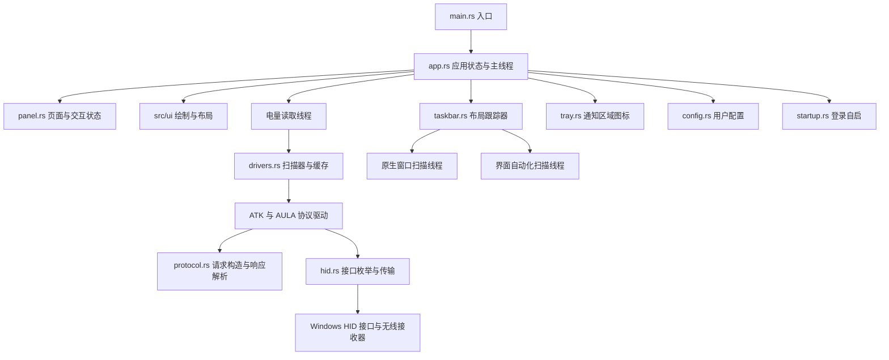
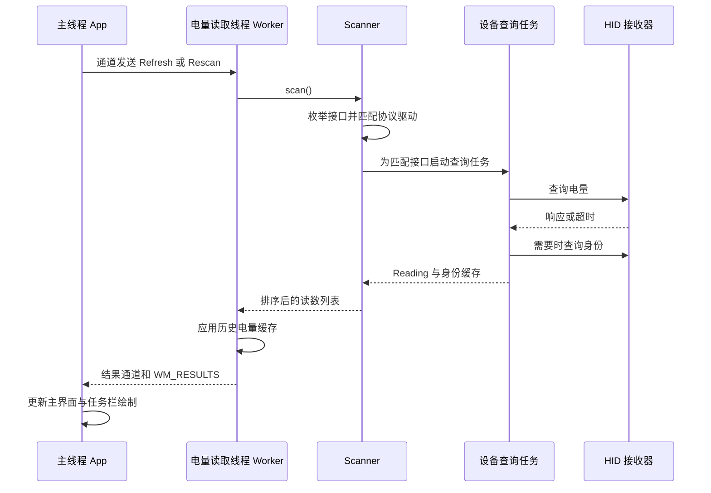

# BatterySentry 架构说明

本文依据当前源码，介绍程序如何从 Windows HID 接口读取设备电量，再把结果显示到主界面和任务栏。文中的模块、类型和函数名均对应项目里的实际代码。

## 一、整体结构

BatterySentry 是一个使用 Rust 开发的 Windows 桌面程序，使用 Win32 消息循环管理窗口，使用 GDI 绘制界面，通过 HID 与受支持的无线接收器通信。

程序运行在一个进程内，主要有三部分工作。

| 工作 | 主要模块 | 负责的内容 |
| --- | --- | --- |
| 应用调度与界面 | `main.rs`、`app.rs`、`panel.rs` | 启动、刷新、窗口交互、绘制、退出 |
| 设备识别与通信 | `drivers.rs`、`protocol.rs`、`hid.rs` | 匹配接口、查询型号和电量、收发 HID 报告 |
| Windows 集成 | `taskbar.rs`、`tray.rs`、`startup.rs`、`config.rs`、`win.rs` | 任务栏位置、通知图标、自启、配置和资源管理 |

这里的 `DeviceDriver` 是程序内部的设备协议实现。它通过 Windows 已有的 HID 接口工作，包含设备匹配条件、查询命令和返回值处理。

## 二、源码目录与职责

| 文件 | 核心职责 | 重点入口 |
| --- | --- | --- |
| [src/main.rs](src/main.rs) | 命令行参数分流、调用应用入口、处理启动错误 | `main()` |
| [src/app.rs](src/app.rs) | 保存应用状态，管理窗口、后台任务、定时器和绘制 | `App`、`Worker`、`run()`、`procedure()` |
| [src/drivers.rs](src/drivers.rs) | 组织设备查询，映射设备型号，缓存身份和历史电量 | `DeviceDriver`、`Scanner`、`ReadingCache` |
| [src/protocol.rs](src/protocol.rs) | 构造协议字节，校验和解析响应 | `BatteryValue`、各品牌的请求与解析函数 |
| [src/hid.rs](src/hid.rs) | 枚举 HID 接口，打开设备，完成有超时控制的读写 | `Interface`、`enumerate()`、`Transport` |
| [src/taskbar.rs](src/taskbar.rs) | 发现任务栏，收集占用范围，计算可放置位置 | `Tracker`、`Layout`、`snapshot()`、`rightmost_gap()` |
| [src/panel.rs](src/panel.rs) | 保存页面、滚动和动画状态 | `Panel` |
| [src/ui/mod.rs](src/ui/mod.rs) | 组织布局、设备、设置、控件和物理像素绘制 | `View`、`Renderer` |
| [src/tray.rs](src/tray.rs) | 管理通知区域图标和右键菜单 | `TrayIcon`、`context_menu()` |
| [src/startup.rs](src/startup.rs) | 读取和设置启动文件夹快捷方式 | `enabled()`、`set_enabled()` |
| [src/config.rs](src/config.rs) | 加载、校验和保存用户配置 | `Config::load()`、`Config::save()` |
| [src/win.rs](src/win.rs) | 封装内核句柄、错误信息、宽字符串和单实例名称 | `Handle`、`wide()`、`desktop_instance_name()` |
| [build.rs](build.rs) | 调用 Windows SDK 资源编译器并把资源链接进程序 | 构建脚本的 `main()` |
| [assets/app.rc](assets/app.rc) | 声明图标、版本信息和应用清单资源 | Windows 资源定义 |
| [assets/app.manifest](assets/app.manifest) | 声明 Windows 系统兼容性，支持分层子窗口使用场景 | 应用清单 |

`tools/` 存放开发检查脚本。`taskbar_smoke.py` 使用模拟任务栏检查布局，`startup_smoke.ps1` 检查后台启动与再次启动打开面板的流程，`smoke.py` 保留较早的界面检查逻辑。这些脚本由开发者手动运行。

## 三、程序从哪里开始运行

### 3.1 命令行分流

`main.rs` 先收集参数，再决定执行哪条路径。

| 参数 | 运行路径 |
| --- | --- |
| `--help` | 输出帮助后结束 |
| `--list` | 调用 `hid::enumerate()`，输出 HID 接口信息后结束 |
| `--once` | 调用 `drivers::scan()`，完成一轮设备查询后结束 |
| 无参数 | 调用 `app::run()`，启动常驻应用并打开面板 |
| `--background` | 调用 `app::run()`，启动常驻应用并保持面板隐藏 |
| `--quit` | 进入应用入口，向同一桌面的已有实例发送退出消息 |

`--list` 和 `--once` 在进入常驻应用之前执行，常驻应用的单实例检查位于 `app::run()` 内。

### 3.2 单实例检查

`win::desktop_instance_name()` 读取当前窗口站和桌面的名称，计算稳定的哈希，生成命名互斥体名称。

`app::run()` 用这个名称创建互斥体。如果发现同一桌面的程序已经运行，就查找已有的隐藏宿主窗口，通过 `PostMessageW()` 发送消息。

- 普通再次启动发送 `WM_OPEN`，要求已有实例打开主界面。
- `--quit` 发送 `WM_EXIT`，要求已有实例退出。
- 再次以 `--background` 启动时保持静默。

窗口站和桌面参与名称计算，使开发工具隔离桌面中的实例与用户桌面中的实例分别管理。互斥体一直保留到退出清理完成。

### 3.3 初始化常驻应用

新实例依次完成以下工作。

1. 设置每显示器 DPI 感知。
2. 注册宿主、面板和任务栏组件的窗口类。
3. 创建 `App`，加载配置并初始化交互状态。
4. 创建隐藏宿主窗口，作为消息接收中心。
5. 启动电量读取线程 `Worker`。
6. 启动任务栏跟踪器 `Tracker`，请求初始布局。
7. 设置电量刷新定时器，初始化可选通知图标。
8. 立即发起第一轮设备扫描。
9. 根据启动参数决定是否打开面板。
10. 进入 `GetMessageW()` 消息循环。

首次扫描在初始化时直接发起。配置中的刷新间隔决定之后的周期刷新频率。

## 四、主线程如何组织整个程序

### 4.1 三种窗口

| 窗口 | 作用 | 生命周期 |
| --- | --- | --- |
| 隐藏宿主窗口 | 接收定时器、后台完成通知、设备变化和托盘消息 | 随常驻应用运行 |
| 主界面窗口 | 显示全部设备与设置，接收用户操作 | 按需创建，可隐藏后重新打开 |
| 任务栏组件窗口 | 在任务栏空闲区域绘制设备名称和电量 | 根据布局创建、隐藏或重建 |

绘制后端位于 `src/ui/renderer.rs`，使用显式 DPI 和物理像素，复用字体与双缓冲。布局位于 `src/ui/layout.rs`，设备、设置和通用控件分别绘制。主题配色与布局尺度集中在 `theme.rs`，设备卡片和独立设置页的实现细节见 [界面改版说明](UI_REDESIGN.md)。

可选通知区域图标由 `TrayIcon` 管理，图标回调消息发送给隐藏宿主窗口。

### 4.2 `App` 保存什么

`App` 是应用状态的集中持有者，包含窗口句柄、当前读数 `readings`、配置 `cfg`、面板交互状态 `ui`、后台线程对象，以及扫描和任务栏布局的状态。

程序使用 `Box<RefCell<App>>` 保存它。`Box` 为传给窗口过程的地址提供稳定存储，`RefCell` 管理同一线程上的可变借用。窗口通过 `GWLP_USERDATA` 保存对应地址。

窗口过程可能因为调用 Win32 函数而同步重入，所以代码使用借用检查，并在会启动嵌套消息循环的菜单操作前释放应用借用。后台线程通过通道交付数据，窗口状态由主线程更新。

### 4.3 消息负责唤醒，通道负责传数据

电量读取线程把 `io::Result<Vec<Reading>>` 放进 Rust 通道，然后发送不带数据指针的 `WM_RESULTS`。

任务栏线程把 `Layout` 放进通道，然后发送 `WM_LAYOUT`。主线程收到消息后，从对应通道取出结果。

这样，数据的所有权由通道转移，Windows 消息只负责通知主线程有工作可处理。界面绘制、窗口移动和显示都在主线程完成。

## 五、一轮电量读取的完整流程

### 5.1 刷新请求与合并

`App::refresh()` 检查当前是否忙碌，再向 `Worker` 发送命令。`busy` 用来避免同时派发多轮扫描。

`Work` 有三种取值。

| 命令 | 行为 |
| --- | --- |
| `Refresh` | 执行正常扫描，复用仍有效的身份缓存 |
| `Rescan` | 清空身份缓存后扫描 |
| `Stop` | 结束读取线程 |

设备热插拔通知经过短暂防抖后触发重新扫描。如果扫描期间又发生需要重新扫描的变化，`refresh_again` 会记住请求，等本轮结果处理完成后再执行。

### 5.2 枚举与接口匹配

`Scanner::scan()` 调用 `hid::enumerate()`，拿到 `Vec<Interface>`。一个物理设备可能暴露多个 HID 接口，因此每个元素描述一条接口路径。

`Interface` 保存路径、VID、PID、Usage Page、Usage、报告长度和产品字符串。驱动根据其中一组条件匹配通信接口。

| 协议实现 | 当前匹配条件 |
| --- | --- |
| ATK | VID `373B`、PID `1216`、Usage Page `FF05`，输入和输出报告均为 64 字节 |
| AULA | VID `3554`、PID `FA09`、Usage Page `FF02`、Usage `0002`，输入和输出报告均为 20 字节 |

接口先按路径排序和去重，扫描结果也按 `device_key` 排序。稳定顺序有助于保持列表和滚动位置稳定。

### 5.3 查询并行度

`Scanner` 为每条匹配的接口创建作用域线程。各接口可以并行查询，同一接口内部按顺序执行电量和身份查询。

每个查询任务独立创建 `Transport`。作用域结束前收集所有结果，最后生成一份完整列表。某个接收器等待响应时，主线程仍可处理窗口消息。

### 5.4 电量与型号分别处理

`scan_interface()` 先查询电量。得到电量后，才根据缓存是否有效决定要不要查询身份。

- ATK 读取 CID/MID，再通过 `atk_model()` 映射型号名称。
- AULA 读取六字节 PSD，再通过 `aula_model()` 映射型号名称。
- 身份查询失败或编号尚未收录时，名称显示为品牌加 `Device`。

`Interface.product` 是设备提供的产品字符串，可用于接口诊断。当前展示名称由协议身份映射产生。

当前 AULA 映射中，`03 00 00 00 01 0B` 按此前选定的有线型号对照显示 `AULA F87 Pro`，`03 00 00 00 01 58` 显示 `AULA F99 Pro`。这些名称取决于代码中已有的对照表，扩展设备支持时需要核实对应关系。

### 5.5 两类缓存

| 缓存 | 所属对象 | 保存内容 | 更新与失效规则 |
| --- | --- | --- | --- |
| 身份缓存 | `Scanner.identities` | 型号查询结果和查询时间 | 已确认型号复用 300 秒，未知结果复用 60 秒，再次成功读取电量后按需更新；重新扫描可主动清空 |
| 历史电量缓存 | `ReadingCache` | 最后一次成功电量和时间 | 当前查询无结果时，最多提供 1800 秒内的历史值 |

两类缓存都以接口路径为键，接收器路径从枚举结果中消失后清理对应记录。接口路径变化会形成新的缓存键。

`Reading` 同时容纳当前值 `value` 和历史值 `last_known`。`value_text()` 优先显示当前电量，例如 `83%`，再考虑历史值，例如 `~83%`，两者都没有时显示 `--`。充电状态用 `Charging` 表示。

这些缓存由电量读取线程持有，保存在进程内存中。

## 六、协议层与 HID 层如何配合

### 6.1 `protocol.rs` 处理字节含义

协议层接收字节切片，返回业务类型。请求构造函数产生报告字节，响应解析函数校验长度、命令、状态、电量范围以及协议要求的校验和。

`BatteryValue` 用两个枚举分支表示百分比和充电状态。解析函数返回 `Option<BatteryValue>`，表示当前报告是否包含可接受的结果。

这层函数可以直接用已知报文理解和验证，设备句柄与 Windows 调用集中在 HID 层。

### 6.2 `hid.rs` 处理系统通信

`enumerate()` 通过 SetupAPI 枚举当前 HID 接口，再读取设备属性和报告能力。`Transport::open()` 为一次设备查询建立读取句柄、写入句柄和事件句柄。

`Transport::exchange()` 组织一次请求响应交换。

1. 最多读取 32 条旧报告，每次等待约 2 毫秒，清理残留数据。
2. 写入本次请求。
3. 在响应截止时间内读取报告。
4. 把每条报告交给传入的解析函数。
5. 解析到匹配结果就返回，否则继续等待，直到超时。

写入优先使用可取消的 HID 输出报告控制请求，遇到系统明确返回不支持时回退到 `WriteFile()`。

读写使用重叠 I/O。超时后调用取消，并等待取消操作完成，再释放缓冲区和 `OVERLAPPED`，使系统异步操作使用的内存保持有效。

驱动层控制协议重试。ATK 电量最多尝试三次，每次响应等待 400 毫秒。AULA 电量最多尝试三次，每次响应等待 1 秒，后续尝试前等待 200 毫秒。单次总耗时还包含写入、旧报告清理和可能的身份查询。

## 七、任务栏显示如何工作

### 7.1 发现位置与绘制窗口分工

`taskbar.rs` 读取 Explorer 窗口和界面自动化信息，产生 `Layout`。`app.rs` 接收布局，创建或更新自己的组件窗口。

`Layout` 包含父窗口、目标矩形、DPI、占用区间、原因文字、请求代数以及是否为临时结果。`Span` 表示水平方向上一段已占用区域。

### 7.2 两条布局计算路径

`Tracker` 启动两个布局相关线程。

| 线程 | 工作 | 结果特点 |
| --- | --- | --- |
| `taskbar-layout` | 用原生窗口几何信息调用 `snapshot(None)` | 提供初步布局，保守处理尚未细分的任务列表区域 |
| `taskbar-accessibility` | 使用 UI Automation 读取按钮、文本等元素范围 | 补充更细的占用范围，可能受 Explorer 响应速度影响 |

界面自动化使用独立 COM 线程。原生扫描完成后会通知主线程，并把同一代请求交给界面自动化线程继续细化。

`generation` 标记请求的新旧。主线程只应用当前请求代数的结果，避免旧扫描结果覆盖新布局。

### 7.3 怎样避开 LiteMonitor

扫描器查找 `Shell_TrayWnd`，读取主任务栏边界，并枚举任务栏子窗口及与任务栏相交的顶层窗口。

对于其他进程创建的窗口，扫描器会按其矩形记录占用范围。LiteMonitor 如果以可枚举的独立窗口出现在任务栏区域，它占据的范围会参与空位计算。通知区域等已知任务栏窗口也会进入占用范围。

因此，LiteMonitor 在登录过程中改变大小或位置，会让 BatterySentry 前后两次计算得到不同空位。识别质量取决于对方暴露的窗口边界及 Windows 返回的信息。

### 7.4 空位选择规则

`rightmost_gap()` 把占用区间裁剪到任务栏边界内，排序并合并影响，找出剩余空白，再从右往左选择足够宽的区域。

当前调用按 DPI 缩放后，以约 200 像素为期望宽度、150 像素为最小宽度。UI Automation 暂时无法细分任务列表时，原生路径会保守预留整个相关容器，这可能把实际空白也视为占用。

任务栏尚未就绪、隐藏、垂直、检测到全屏应用或没有足够空位时，布局可能返回空矩形，并附上原因文字。

### 7.5 组件窗口的显示

`App::apply_layout()` 根据结果创建分层窗口，调整为子窗口并尝试挂到任务栏。挂载受阻时，代码保留非激活顶层窗口的回退路径。

显示时会设置透明色、位置、尺寸和窗口层级。组件通过 GDI 双缓冲绘制设备名称与电量，主界面和任务栏共用 `App.readings` 中的结果。

任务栏最多直接绘制前两台设备，更多设备在第二行附加数量提示。组件 DPI 与任务栏 DPI 对齐，文字颜色随任务栏明暗主题变化。

### 7.6 布局更新与三秒重试

窗口事件钩子监听任务栏相关的窗口变化和前台切换。相关事件经 250 毫秒定时器防抖后请求重新计算。Explorer 重启后，程序通过 `TaskbarCreated` 消息恢复通知图标并重新挂载组件。

当前重试逻辑集中在 `App::layout_failed()`、`apply_layout()` 和宿主窗口的 4 号定时器中。

1. 布局无法显示组件，或组件创建、透明设置、定位失败时，启动一个 3 秒定时器。
2. 定时器等待期间允许原生结果和界面自动化结果继续更新。重复失败通知沿用已有截止时间。
3. 如果期间成功显示组件，取消重试定时器，清零失败次数。
4. 3 秒后仍未恢复，就记一次持续失败，并请求再次计算。
5. 连续三个等待周期均失败时，自动打开主界面。理想调度下约为首次失败后的 9 秒，实际会受消息处理和计算耗时影响。
6. 同一轮持续失败只自动打开一次，后台继续重试。恢复成功后，下一轮失败重新计数。

原生结果和界面自动化结果可能来自同一次请求，因此计数依据持续失败的等待周期。已有组件仍可安全保留在原位置时，临时布局会保留它并清零失败状态。

布局通过 `intentionally_hidden` 标记主动隐藏场景。检测到全屏应用，或者任务栏处于隐藏、垂直等状态时，程序清零失败次数并继续每 3 秒检测恢复条件。这些场景会保持后台运行；自动弹出主界面由真正的布局或组件显示失败触发。

## 八、主界面与通知图标

`panel.rs` 保存设备页和设置页状态、控件边界、悬停、按下、键盘焦点、各页滚动位置和动画进度。`app.rs` 处理 Windows 输入消息，再把界面状态交给 `ui::View` 绘制。

设备列表按行高计算可见范围，只绘制可见行，形成虚拟滚动。窗口拉伸会增加可显示空间，尺寸按逻辑像素保存。刷新结果到达后，会尽量用设备键保留用户当前浏览的位置。

面板的关闭操作会隐藏窗口，最小化操作使用系统最小化行为，电量读取及任务栏功能继续运行。`Exit` 和 `--quit` 进入完整退出流程。

通知区域图标通过 `Shell_NotifyIconW()` 添加和删除，配置项 `show_tray_icon` 控制显示。托盘菜单可打开界面、刷新或退出；即使图标隐藏，普通再次运行 EXE 仍可通知已有实例打开面板。

## 九、配置、自启与构建资源

### 9.1 配置文件

配置保存于 `%LOCALAPPDATA%\BatterySentry\settings.ini`。

| 配置项 | 含义 | 默认值 |
| --- | --- | --- |
| `interval` | 周期刷新间隔，单位为秒 | `60` |
| `window_width` | 主界面逻辑宽度 | `420` |
| `window_height` | 两台设备时的主界面逻辑高度 | `340` |
| `window_size_manual` | 是否保留手动调整的尺寸 | `0` |
| `show_tray_icon` | 是否显示通知区域图标 | `1` |

刷新间隔仅接受预设选项。配置读取失败或字段不合法时使用默认值。保存时先写临时文件，再通过替换操作更新正式文件。

### 9.2 登录自启

开启自启时，`startup.rs` 通过 COM 创建启动文件夹中的 `BatterySentry.lnk`，目标为当前进程的 EXE，并设置 `--background` 参数和工作目录。

自启状态由快捷方式是否存在以及 Windows 启动项批准记录共同判断。显式开启自启时会尝试清除对应的禁用记录；关闭时删除快捷方式。移动 EXE 后需要重新设置快捷方式目标。

### 9.3 资源编译

`build.rs` 查找 Windows SDK 的 x64 `rc.exe`，把 `assets/app.rc` 编译成资源文件并链接进 EXE。

资源包括图标、版本信息和 `app.manifest`。当前清单声明 Windows 10/11 兼容性，服务于任务栏组件使用分层子窗口的场景。MSVC 构建使用已嵌入的清单资源。

## 十、资源释放与退出

`win::Handle` 持有内核句柄，离开作用域时通过 `Drop` 调用 `CloseHandle()`。HID 枚举集合、通知图标和 COM 初始化也各自通过对应清理逻辑释放资源。

应用退出时，主线程移除通知图标并销毁组件和面板，结束消息循环，然后停止布局跟踪和电量读取，最后释放应用状态及单实例互斥体。

电量读取线程接收 `Stop` 后结束，退出路径等待它完成。布局跟踪器移除事件钩子并发送停止信号，关闭流程对尚未结束的布局线程采用放开线程句柄的处理。界面自动化线程拥有自己的 COM 对象，通过通道和窗口通知与应用交互。

## 十一、按功能定位代码

| 想理解或修改的行为 | 优先阅读位置 |
| --- | --- |
| 请求字节、电量位置、响应校验 | `protocol.rs` |
| 接收器匹配、型号名称、查询重试 | `drivers.rs` |
| 多个 HID 接口、句柄、超时与取消 | `hid.rs` |
| 电量刷新、后台线程与结果更新 | `app.rs` 的 `Worker`、`refresh()`、`results()` |
| 任务栏空位、与 LiteMonitor 共存 | `taskbar.rs` 的 `snapshot()`、`collect_native()`、`rightmost_gap()` |
| 组件消失、重试和自动打开面板 | `app.rs` 的 `apply_layout()`、`layout_failed()`、`WM_TIMER` 分支 |
| 窗口缩放、滚动、控件命中 | `ui/layout.rs`、`panel.rs`，再看 `app.rs` 的输入与尺寸处理 |
| 双击启动、自启后台运行、重复启动 | `main.rs`、`app::run()`、`startup.rs`、`desktop_instance_name()` |

阅读主要逻辑可以按 `protocol.rs` → `drivers.rs` → `hid.rs` → `app.rs` 的读取线程与结果处理 → `taskbar.rs` → `app.rs` 的窗口生命周期展开，再补充配置、自启和通知图标。这样能先理解数据从哪里来，再理解数据如何驱动桌面显示。
